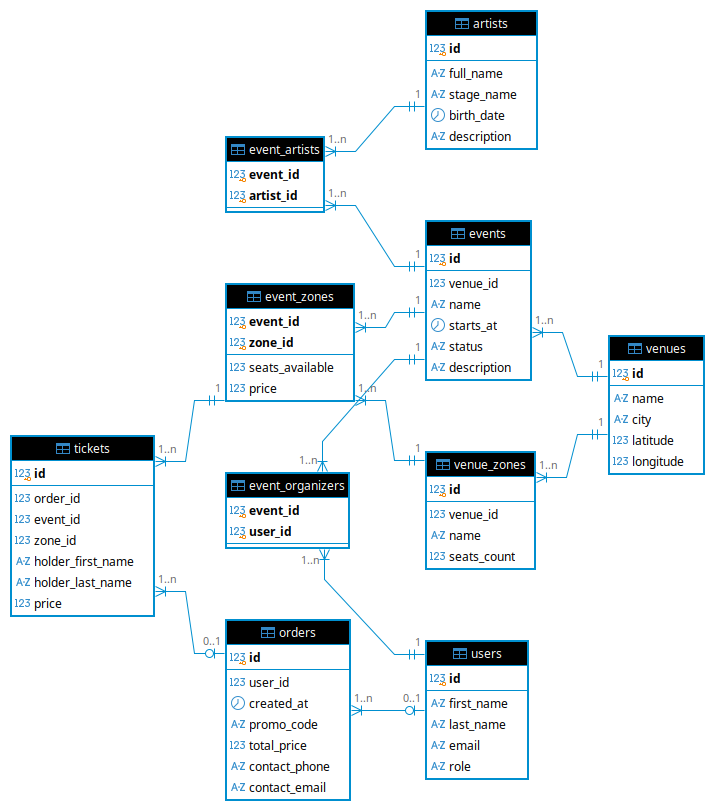

# ЛР 1. Проектирование и реализация реляционной базы данных

**Вариант 12 — сервис продажи билетов на мероприятия.**

Спроектировать реляционную модель в 3НФ, построить ER-диаграмму, реализовать базу в PostgreSQL, заполнить тестовыми данными и продемонстрировать работу ограничений целостности.

## Предметная область

Организаторы проводят мероприятия (концерты, спектакли, фестивали) на площадках, пользователи покупают на них билеты.

Площадка делится на зоны (партер, балкон, танцпол) с фиксированным числом мест. Для каждого мероприятия задаётся, какие зоны продаются, по какой цене и сколько мест осталось. В одном заказе могут быть билеты на разные мероприятия и на разных людей. Билет выписывается на конкретного человека в конкретную зону мероприятия.

## Модель

| Таблица | Содержание | Ключ |
|---|---|---|
| `users` | пользователи (роль `user` / `organizer`) | `id` |
| `venues` | площадки | `id` |
| `venue_zones` | зоны площадки и число мест | `id` |
| `events` | мероприятия | `id` |
| `event_organizers` | организаторы мероприятия (M:N) | `(event_id, user_id)` |
| `artists` | артисты | `id` |
| `event_artists` | артисты мероприятия (M:N) | `(event_id, artist_id)` |
| `event_zones` | зона на мероприятии: цена и остаток мест | `(event_id, zone_id)` |
| `orders` | заказы | `id` |
| `tickets` | билеты | `id` |

```
venues      1 ── N  venue_zones
venues      1 ── N  events
users       1 ── N  orders        (user_id может быть NULL)
orders      1 ── N  tickets       (order_id может быть NULL)
event_zones 1 ── N  tickets       составной FK (event_id, zone_id)

events  M ── N  users        через event_organizers
events  M ── N  artists      через event_artists
events  M ── N  venue_zones  через event_zones
```



Та же диаграмма в нотации IDEF1X: [er-diagram-idef1x.png](er-diagram-idef1x.png).

## Проектные решения

- **Суррогатные ключи** `GENERATED ALWAYS AS IDENTITY`: email и названия могут меняться и повторяться. `ALWAYS` запрещает вставлять id вручную, поэтому значения не конфликтуют со счётчиком.
- **`event_zones` — отдельная таблица:** цена зависит от пары «мероприятие + зона», а не от каждого по отдельности.
- **Составной FK билета** `(event_id, zone_id) → event_zones`: нельзя продать билет в зону, которая на это мероприятие не продаётся. Два отдельных FK этого бы не обеспечили.
- **Контакты в заказе**, а не только в профиле: заказ может оформляться на другого человека. Минимум один контакт обязателен.
- **Цена в билете** — цена на момент покупки: текущая цена зоны может измениться.
- **Типы:** деньги — `NUMERIC(10,2)`, моменты времени — `TIMESTAMPTZ`, координаты — `NUMERIC(9,6)`, телефон — строка.
- **ON DELETE по смыслу:**
  - `CASCADE` — для данных, которые без родителя не имеют смысла: зоны зала, связи M:N, цены зон;
  - `RESTRICT` — нельзя удалить зал с мероприятиями и мероприятие с проданными билетами (его отменяют статусом);
  - `SET NULL` — заказы сохраняются после удаления пользователя, билеты — после удаления заказа.

## Ограничения целостности

| Требование задания | Реализация |
|---|---|
| ≥ 5 таблиц | 10 |
| UNIQUE (≥ 2) | `users.email`; `venue_zones (venue_id, name)` |
| CHECK (≥ 3) | формат email; роль и статус из списка; диапазоны координат; места и цены неотрицательны; дата рождения в прошлом; в заказе есть телефон или email |
| составное ограничение | PK таблиц связей; UNIQUE `(venue_id, name)`; FK `tickets (event_id, zone_id)`; CHECK контактов заказа |
| NOT NULL | на всех обязательных атрибутах |
| ≥ 5 отклоняемых операций | 18 в [constraints_test.sql](constraints_test.sql) + демонстрация `ON DELETE` |

## Нормализация (3НФ)

- **1НФ:** значения атомарные; списки (артисты, организаторы, билеты заказа) вынесены в отдельные таблицы.
- **2НФ:** составные ключи есть только у таблиц связей. В `event_zones` цена и остаток зависят от всей пары `(event_id, zone_id)`. У остальных таблиц ключ простой.
- **3НФ:** каждый атрибут описывает сущность своей строки: город — у площадки, число мест — у зоны, дата заказа — у заказа. Из черновика удалён `tickets.date_of_buy` — транзитивная зависимость через `order_id`.

## Известные ограничения модели

Выявлены при защите, исправляются миграцией в ЛР 2:

- `orders.total_price` и `event_zones.seats_available` — хранимые вычисляемые значения (дублирование данных).
- Остаток мест одной строкой на зону создаёт конкуренцию за блокировку при одновременных покупках и риск взаимной блокировки при заказе в несколько зон.
- Организатор смоделирован как роль пользователя, хотя по смыслу это юридическое лицо.
- У заказов и билетов нет статусов, поэтому отмену и возврат нельзя выразить без удаления данных.

## Файлы

| Файл | Содержание |
|---|---|
| [schema.sql](schema.sql) | создание структуры БД |
| [data.sql](data.sql) | тестовые данные |
| [constraints_test.sql](constraints_test.sql) | некорректные операции и демонстрация `ON DELETE` |
| [er-diagram-crowsfoot.png](er-diagram-crowsfoot.png), [er-diagram-idef1x.png](er-diagram-idef1x.png) | ER-диаграммы |

Изменение требований на защите не выдавалось.

## Запуск

Из корня репозитория:

```bash
docker compose up -d
docker compose exec db psql -U student -d labs -f /labs/lab1/schema.sql
docker compose exec db psql -U student -d labs -f /labs/lab1/data.sql
docker compose exec db psql -U student -d labs -f /labs/lab1/constraints_test.sql
```

`schema.sql` и `data.sql` можно запускать повторно: первый пересоздаёт таблицы, второй очищает их и сбрасывает счётчики id.
