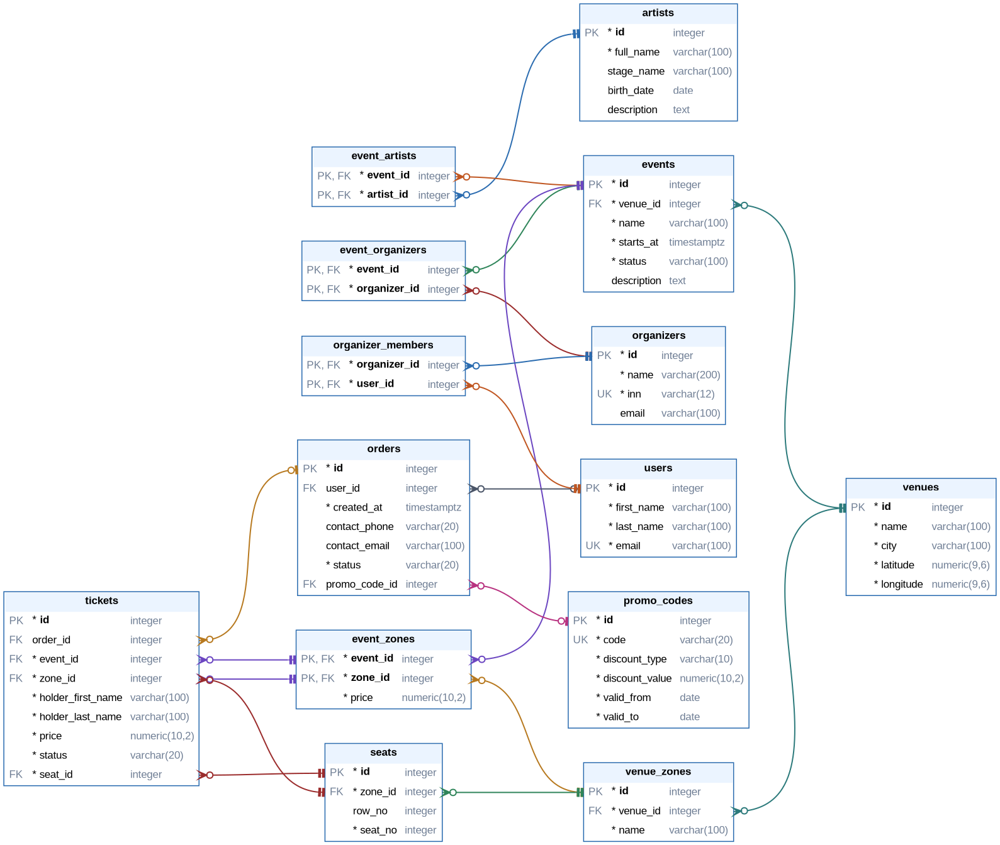

# ЛР 2. SQL-запросы и аналитические сценарии

**Вариант 12 — сервис продажи билетов на мероприятия.** Выполняется на модели из [ЛР 1](../lab1/).

Модель расширена миграцией: исправлены замечания с защиты ЛР 1, данные ЛР 1 сохранены. Затем база дополнена данными, на ней реализованы DML-сценарий, запросы и аналитический отчёт.

## Миграция модели

[migration.sql](migration.sql) применяется к базе ЛР 1 одной транзакцией.

| Замечание к ЛР 1 | Изменение | Перенос данных |
|---|---|---|
| Организатор — роль пользователя, хотя по смыслу это юрлицо | `organizers` (название, ИНН) и `organizer_members` (пользователи юрлица); `event_organizers` ссылается на `organizers`; `users.role` удалён | для каждого организатора из ЛР 1 создано юрлицо; связь с мероприятиями перенесена через `UPDATE ... FROM` |
| `seats_available` — хранимое вычисляемое значение и «горячая» строка при покупках | `seats` — конкретные места (ряд, номер); билет ссылается на место; `seats_count` и `seats_available` удалены | места сгенерированы из `seats_count`; существующим билетам выданы первые места их зон (`ROW_NUMBER`) |
| `total_price` дублирует сумму билетов | столбец удалён, сумма считается запросом | — |
| Промокод — просто строка | `promo_codes`: тип скидки (процент / сумма), размер, срок действия | AUTUMN10 и VIP500 перенесены, заказы связаны по коду |
| Нет статусов | `orders.status`: `pending` / `paid` / `cancelled`; `tickets.status`: `active` / `used` / `refunded` | заказы ЛР 1 — `paid`, билеты прошедших мероприятий — `used` |

Перед удалением старых столбцов миграция проверяет, что новые данные выражают то же самое: `seats_available` = мест − билетов, `total_price` = сумма билетов − скидка. При расхождении транзакция откатывается.



Линия соединяет столбец FK со столбцом, на который он ссылается; составной FK — несколько линий одного цвета. `*` — NOT NULL. Диаграмма строится по каталогу базы: `python3 tools/er_diagram.py lab2/er-diagram`.

### Новые ограничения

- **Место продаётся один раз:** частичный уникальный индекс `(event_id, seat_id) WHERE status <> 'refunded'`. Сданное место можно продать снова.
- **Место — из зоны билета:** составной FK `(seat_id, zone_id) → seats (id, zone_id)`. Вместе с FK `(event_id, zone_id) → event_zones` гарантирует, что место находится в зоне, которая продаётся на это мероприятие.
- **Стоячие зоны** (танцпол, бар-зона): места без ряда (`row_no IS NULL`), номер — входной слот. `UNIQUE NULLS NOT DISTINCT (zone_id, row_no, seat_no)` запрещает повтор слота.
- ИНН — 10 или 12 цифр; процентная скидка не больше 100; срок действия промокода не пустой.

### Чего база не проверяет

Эти правила связывают несколько таблиц, и их можно было бы обеспечить триггерами:

- билеты отменённого заказа должны быть возвращены;
- промокод применяется только в срок своего действия;
- билет не продаётся на отменённое или прошедшее мероприятие.

## 1.1. Данные

[data.sql](data.sql) только добавляет строки к данным ЛР 1.

| Требование | Как выполнено |
|---|---|
| ≥ 100 записей, ≥ 30 в операционной таблице | 37 заказов, 63 билета, всего 222 строки (без 3810 мест) |
| ≥ 3 состояния процесса | заказы `paid` / `pending` / `cancelled`; билеты `active` / `used` / `refunded` |
| ≥ 3 месяцев | заказы за март, май, июнь, июль, август, сентябрь и октябрь 2026 |
| Повторяющиеся операции | Петров — 4 заказа, у Волковой, Сафина, Ковалёвой и других — по 2–3 |
| Сущности без операций | пользователи без заказов, организатор «Казань Лайв» без мероприятий, артист без выступлений, «Новогодний концерт» без продаж, неиспользованный промокод |
| Пограничные значения и NULL | бесплатные билеты и заказ на 0 ₽; пригласительные без заказа; заказ без пользователя; контакт только телефоном или только email; место, сданное и проданное повторно |

## 1.2. DML

[dml.sql](dml.sql):

1. **INSERT:** новое мероприятие вместе с организатором, артистом и зонами — одна команда с CTE: id мероприятия передаётся в связанные таблицы через `RETURNING`.
2. **UPDATE состояния:** заказ из `pending` переходит в `paid`.
3. **Массовый UPDATE:** прошедшие мероприятия становятся `completed`, их активные билеты — `used`. Одна транзакция.
4. **DELETE:** использованный промокод удалить нельзя (FK `RESTRICT`), неиспользованный удаляется.
5. **ROLLBACK:** повышение цен на фестиваль откатывается.

## 2–3. Запросы

[queries.sql](queries.sql):

| № | Задача | Приёмы |
|---|---|---|
| 2.1.1 | Список зрителей мероприятия для контроля на входе | JOIN 6 таблиц, LEFT JOIN для пригласительных |
| 2.1.2 | Зоны предстоящих мероприятий без единой продажи | LEFT JOIN + `IS NULL`, условие в `ON` |
| 2.1.3 | Зрители предстоящих мероприятий для SMS-рассылки | JOIN 4 таблиц, несколько условий |
| 2.2.1 | Заказы, продажи и возвраты по мероприятиям | `COUNT`, `COUNT(DISTINCT)`, `FILTER` |
| 2.2.2 | Площадки со средней ценой билета выше 2000 ₽ | `SUM`, `AVG`, `HAVING` |
| 2.2.3 | Сравнение месяцев: заказы по статусам, выручка, цены | `date_trunc`, `MIN`, `MAX`, `SUM` |
| 3.1 | Мероприятия, где продано больше среднего по площадке | сравнение с показателем группы |
| 3.2 | Покупатели, оплачивавшие VIP-ложу | `EXISTS` |
| 3.3 | Покупатели без оплаченных заказов | `NOT EXISTS` |
| 3.4 | Вместимость и продажи каждого мероприятия | коррелированные подзапросы |

## 4. Аналитический отчёт

[report.sql](report.sql) отвечает на вопрос: **какие мероприятия приносят больше всего выручки с учётом скидок, насколько они заполнены и какое место занимают на своей площадке.**

| Этап | CTE | Вход → результат |
|---|---|---|
| Исходные данные | `sales` | билеты → проданные билеты оплаченных заказов и пригласительные |
| Промежуточные показатели | `order_totals`, `sales_net` | сумма каждого заказа и скидка по промокоду → цена каждого билета за вычетом его доли скидки |
| Агрегация | `event_stats` | билеты → по мероприятию: вместимость, продано, выручка до и после скидок |
| Итоговый отчёт | финальный `SELECT` | заполняемость, средняя цена, доля в выручке площадки и место (`RANK`) |

Скидка заказа распределяется по билетам пропорционально цене: в одном заказе могут быть билеты на разные мероприятия.

## Файлы

| Файл | Содержание |
|---|---|
| [setup.sql](setup.sql) | пересоздание базы: схема и данные ЛР 1 → миграция → данные ЛР 2 |
| [migration.sql](migration.sql) | изменение модели с сохранением данных |
| [data.sql](data.sql) | дополнительные данные |
| [dml.sql](dml.sql) | задание 1.2 |
| [queries.sql](queries.sql) | задания 2.1–3.4 |
| [report.sql](report.sql) | задание 4 |
| [er-diagram.png](er-diagram.png), [er-diagram.dot](er-diagram.dot) | ER-диаграмма новой схемы (Graphviz) |

## Запуск

Из корня репозитория:

```bash
docker compose exec db psql -U student -d labs -v ON_ERROR_STOP=1 -f /labs/lab2/setup.sql
docker compose exec db psql -U student -d labs -f /labs/lab2/dml.sql
docker compose exec db psql -U student -d labs -f /labs/lab2/queries.sql
docker compose exec db psql -U student -d labs -f /labs/lab2/report.sql
```

`setup.sql` удаляет всё в схеме `public` и собирает базу заново. В `dml.sql` одна ошибка ожидаемая (пункт 4а), поэтому он запускается без `ON_ERROR_STOP`.
